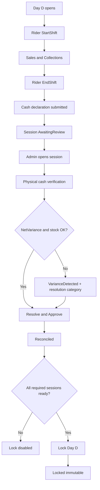

# W07 Settlement & Day-Lock Workflow — Phase 2

## 1. Session identity

A **settlement session** is uniquely keyed by:

```
(BusinessDate D, RiderId R)  [+ optional ShiftId when a shift exists]
```

Projected from existing activity even before a settlement row is saved:

- Active/inactive rider roster  
- Open/closed `Shifts` for `D`  
- Sales / collections for `D`  

Persisted settlement row becomes required once declaration, vault verify, draft, or approve occurs.

## 2. Status model

| Status | Meaning | Editable? |
|---|---|---|
| `NotStarted` | Rider eligible; no submission/declaration | Yes (awaiting field activity) |
| `AwaitingReview` | Declaration and/or shift closed; manager not finished | Yes |
| `VarianceDetected` | Net or stock variance unresolved | Yes |
| `Reconciled` | Manager approved; variances resolved or accepted under category | No cash edits; unlock only via approved correction |
| `Locked` | Included in a locked business day | Immutable under normal edit |

Tab counts are **server-side** over the full filtered universe for `D`, not the current page.

## 3. Happy path



## 4. Manager actions

| Action | Preconditions | Effects |
|---|---|---|
| Save Draft | Admin; session not Locked; remarks/category optional per draft rules | Persist draft fields; status stays AwaitingReview or VarianceDetected; audit `ManagerDecisionSaved` |
| Verify Cash | Admin; amount ≥ 0; session not Locked | Insert/update physical verification; audit `PhysicalVaultCount` |
| Resolve & Approve | Admin; verification present when cash expected; category valid; remarks if required by threshold; stock flags acknowledged | Status → Reconciled; audit `SettlementApproved` |
| Lock Day | Admin; readiness all green | `DayLock` row; sessions → Locked; audit `DayLocked` |
| Bulk Lock | Same checks **per date** independently | Per-date success/fail result; failed dates excluded |

## 5. Day-lock readiness checklist

All must be true for date `D` (Main Warehouse / single depot context):

1. Every **required** eligible rider has a submission/declaration (policy: riders with Open/Closed shift or any cash activity that day).  
2. No session in `AwaitingReview` or `VarianceDetected` without resolution.  
3. Physical verification completed for sessions with ExpectedCash > 0 (or explicit zero-cash approve).  
4. Required stock discrepancies resolved or categorized.  
5. Failed sync sales/activity for `D` recovered or explicitly resolved.  
6. No pending gateway sync **if** gateway configured; if not configured, checklist item = N/A (not a blocker).  
7. End-of-day queue acknowledged (API flag / admin confirm).  

Lock button disabled until `GET …/lock-readiness` returns `ready: true`.

## 6. Concurrency

- Optimistic concurrency token on settlement session row.  
- Approve and Lock run in DB transactions.  
- Second concurrent approve → 409 Conflict.  
- Idempotent lock: second lock of same date returns already locked.

## 7. Audit events (append-only)

| EventCode | Typical actor |
|---|---|
| DayStarted | Rider (`StartShift`) |
| RiderSubmission | Rider declaration |
| PhysicalVaultCount | Admin |
| StockReturnVerification | Admin |
| VarianceDetected | System on compute |
| ManagerReviewStarted | Admin (first open/save) |
| ManagerDecisionSaved | Admin draft |
| SettlementApproved | Admin |
| DayLocked | Admin |

Store in dedicated `SettlementAuditEvents` **or** typed `AuditLogs` with stable `Action` codes — prefer dedicated table for timeline detail without overloading general audit.

## 8. Rider EndShift vs Day Lock

| | `POST /api/shifts/end` | Day Lock |
|---|---|---|
| Actor | Rider | Admin |
| Scope | One shift | Whole business date |
| Cash/vault | No | Yes |
| Reversible | N/A | Only via approved correction |

Never treat shift end as day lock.
