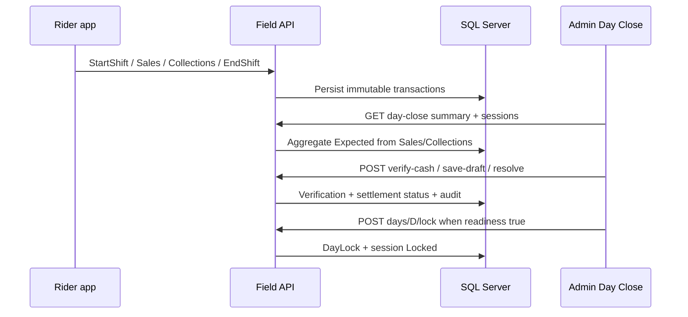
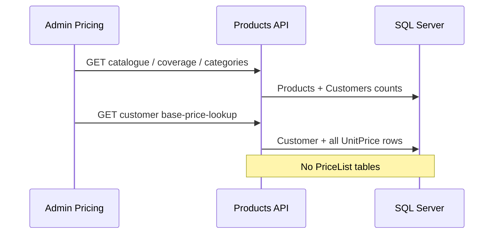

# W07 / W09 Screen Wireframes — Phase 2

Locked V1 tokens: primary `#1565C0`, navy sidebar, light workspace, Noto Sans.  
Reuse `AdminShell` / sidebar / topbar. No competing design system.  
**No fake KPI numbers in implementation** — wireframes use labels/`{api}` placeholders only.

---

## Navigation (both modules)

```
Sidebar (existing + new keys)
├── Admin Dashboard
├── Dispatch & Orders
├── Day Close & Recon          ← NEW AdminNav.dayClose
├── Fleet Couriers
├── Products & Base Pricing    ← NEW AdminNav.basePricing  (NOT "Price Lists")
├── Setup Checklist
└── HQ Settings (unavailable until built)

Excluded from nav: Live Trackboard, Spot Billing, Price Lists (multi-tier)
```

---

## W07 — Day Close & Cash Reconciliation

### W07-1 Desktop layout (~55% / ~40%)

```
┌─ AdminShell ─────────────────────────────────────────────────────────┐
│ Sidebar │ Topbar: breadcrumb · search · date · warehouse · gateway   │
│         ├────────────────────────────────────────────────────────────┤
│         │ [Header card] Day Close & Cash Reconciliation              │
│         │ Settlement Mode · Export Audit · Bulk Lock Days            │
│         ├────────────────────────────────────────────────────────────┤
│         │ [KPI1] [KPI2] [KPI3] [KPI4] [KPI5]                         │
│         ├──────────────────────────┬─────────────────────────────────┤
│         │ LEFT ~55%                │ RIGHT detail ~38%               │
│         │ Tabs: All|Awaiting|…     │ Session header + status         │
│         │ Search · Route filter    │ 3-way cash ledger               │
│         │ Sessions table           │ Rider annotation                │
│         │ SOP banner               │ Stock cards                     │
│         │ Pagination               │ Manager decision form           │
│         │                          │ Audit timeline                  │
│         └──────────────────────────┴─────────────────────────────────┤
└──────────────────────────────────────────────────────────────────────┘
```

### W07-2 Header wireframe

| Element | Source |
|---|---|
| Breadcrumb | Field Operations › Day Close & Reconciliation |
| Mode badge | Settlement Mode |
| Title / blurb | Static Locked V1 copy |
| Date picker | Selected `businessDate` → reload summary + sessions |
| Warehouse | Single Main Warehouse from `Depots` / overview — not multi-hub switcher |
| Gateway chip | **Gateway Integration Not Configured** (until real integration) |
| Export Audit | Opens export for current filters |
| Bulk Lock Days | Dialog → multi-date readiness results |

### W07-3 KPI strip

| Card | Primary | Secondary |
|---|---|---|
| Riders Submitted | `{submitted} / {eligible}` | Remaining + progress bar |
| Expected Cash | `PKR {expected}` | vs yesterday only if API returns comparison |
| Declared Cash | `PKR {declared}` | `{declaredSessions}` submissions |
| Physically Received | `PKR {vault}` | `{batches}` batches |
| Unresolved Variance | `PKR {netUnresolved}` | `{flags}` flags (emphasis if ≠ 0) |

Empty/error: “No totals returned” / retry — never invent 245,800.

### W07-4 Session tabs + table

**Tabs:** All · Awaiting Review · Variance Detected · Reconciled · Locked  
Each shows `{count}` from status-counts API.

**Columns:** Session/Rider · Route & Shift · Expected · Received · Variance · Status  

**Row click:** select session → load right panel (desktop) or push full-screen detail (mobile).  
**States:** loading skeleton · empty (“No settlement sessions found for this date.”) · error · selected highlight.

### W07-5 Detail panel sections

```
┌─ Shift Settlement Audit — {riderName} ({sessionCode}) ─┐
│ Status pill · date · route · expand                    │
├─ Three-way ledger ─────────────────────────────────────┤
│ [Expected PKR] [Declared PKR] [In Vault PKR]           │
│ each: amount · variance vs expected/declared · refs    │
├─ Rider annotation ─────────────────────────────────────┤
│ note · submittedAt · or “No annotation returned.”      │
├─ System variance ──────────────────────────────────────┤
│ Decl / Phys / Net with sign convention                 │
├─ Van stock ────────────────────────────────────────────┤
│ [Full bottles] [Empty returns] discrepancy alerts      │
├─ Manager decision ─────────────────────────────────────┤
│ Verified cash · Resolution category · Remarks          │
│ [Save Draft] [Resolve & Approve] [Lock Day*]           │
├─ Audit trail ──────────────────────────────────────────┤
│ chronological events (API only)                        │
└────────────────────────────────────────────────────────┘
* Lock Day on panel may deep-link to day readiness; primary lock is header/bulk.
```

### W07-6 Dialogs

| Dialog | Fields / behavior |
|---|---|
| Bulk Lock Days | Multi-date picker; per-date ready/fail list; confirm |
| Export Audit | Format PDF/XLS; uses current date+filters; auth required |
| Lock blocked | Lists failed readiness checks from API |
| Approve confirm | Shows NetVariance + category; irreversible notice |

### W07-7 Mobile

```
KPI cards stack → session list cards → tap → full-screen detail
(drawer/page) with back · same sections · bottom action bar
```

### W07-8 State matrix

| State | UI |
|---|---|
| No sessions | Empty table + zero KPIs |
| Loading summary | KPI placeholders / spinner |
| Gateway absent | Not Configured chip |
| Session locked | Form disabled; read-only ledger |
| Approve validation fail | Inline errors; no partial status change |
| Concurrent approve | Notice conflict; refresh detail |

---

## W09 — Products & Base Pricing (compliant)

### W09-1 Desktop (~28% / ~68%)

```
┌─ AdminShell ─────────────────────────────────────────────────────────┐
│ Sidebar │ Business Management › Products & Base Pricing              │
│         ├────────────────────────────────────────────────────────────┤
│         │ Title · Export Product Matrix · Audit Price Changes        │
│         │ (NO Create Price List)                                     │
│         ├────────────────────────────────────────────────────────────┤
│         │ [Immutable Ledger Synchronization banner]                  │
│         ├────────────────────────────────────────────────────────────┤
│         │ [Active Products] [Coverage] [Customers] [Unpriced]        │
│         ├───────────────┬────────────────────────────────────────────┤
│         │ Categories    │ Matrix: Product·SKU · Unit · Base · Status │
│         │ (from flags/  │ Search · status filter · pagination        │
│         │  UnitLabel)   ├────────────────────────────────────────────┤
│         │               │ Base Price Validation panel                │
│         │               │ Product · Qty · Subtotal = price × qty     │
│         │               │ Customer lookup (base model only)          │
│         └───────────────┴────────────────────────────────────────────┘
└──────────────────────────────────────────────────────────────────────┘
```

### W09-2 KPI replacements

| Card | Content |
|---|---|
| Active Products | count + category group count |
| Base Price Coverage | priced / active · % |
| Customer Accounts | non-deleted customers · “Base pricing model” |
| Unpriced Products | count · Resolve → filter unpriced |

### W09-3 Left category cards

Groups (examples of structure, data from API):

- Sale catalogue (`ShowOnSale`)  
- Shift / asset (`ShowOnShift`)  
- Returnable units (`IsReturnable`)  
- By `UnitLabel` (unit / pack)  

**Not** Retail / Wholesale / Zone / Corporate price lists.

### W09-4 Matrix columns (V1)

Product Name & SKU · Unit · Base System Price · Effective Base Price · Price Status  

Omit cost/margin/difference unless cost data exists (it does not).

### W09-5 Validation + customer lookup

```
Product select · SKU · Unit · Approved base · Last change (or “No history”)
Quantity · Read-only subtotal PKR (decimal)
Customer select · “Approved base pricing applies to all accounts”
NO assign-to-price-list · NO discounts · NO Net-30
```

### W09-6 Mobile

Stack: banner → KPIs → category chips → matrix cards → validation sheet.

---

## Workflow wireframes (cross-screen)

### Cash close path



### Base price read path



---

## Component inventory → Phase 3/8 Flutter

### W07

`DayCloseHeader` · `SettlementKpiCard` · `SettlementStatusTabs` · `SettlementFilterToolbar` · `SettlementSessionsTable` · `SettlementDetailPanel` · `CashLedgerComparison` · `RiderAnnotationCard` · `StockReconciliationCard` · `ManagerDecisionForm` · `SettlementAuditTimeline` · `SettlementSopBanner` · `DayLockConfirmationDialog` · `GatewayStatusChip`

### W09

`BasePricingHeader` · `PricingInformationBanner` · `CatalogueKpiCard` · `ProductCategoryCard` · `ProductBasePriceTable` · `ProductSearchToolbar` · `BasePriceValidationPanel` · `CustomerBasePriceLookup` · `PriceChangeAuditPanel`

Shared: existing `AdminShell`, tokens, load/error/empty patterns from Dispatch.

---

## Phase gate

Phase 2 ends when:

- [x] Financial formulas mapped  
- [x] Day-lock workflow mapped  
- [x] Additive schema proposed (not applied)  
- [x] Screen wireframes documented  

Phase 3 next: Flutter W07 layout against these wireframes with honest empty/loading states (still no fake money).
